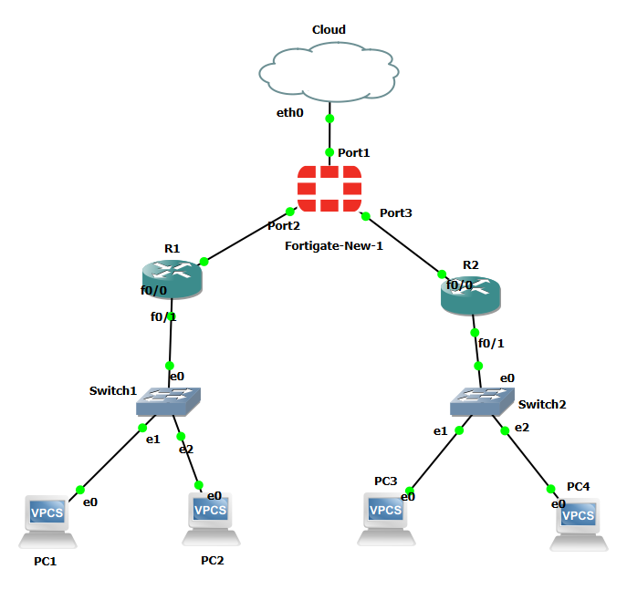

# FortiGate Firewall Configuration Lab

## 1. Lab overview

This lab uses a FortiGate firewall connected to a cloud network, two routers, two switches, and four VPCS end devices. The exercises cover basic FortiGate administration, interface and DHCP configuration, routing, IPv4 firewall policies, security profiles, monitoring, logging, backup, and restore.

## 2. Network topology

### Devices and connections

| Device | Interface | Connected to |
|---|---|---|
| Cloud | `eth0` | FortiGate `port1` |
| FortiGate | `port1` | Cloud |
| FortiGate | `port2` | Router R1 `f0/0` |
| FortiGate | `port3` | Router R2 `f0/0` |
| Router R1 | `f0/1` | Switch1 `e0` |
| Switch1 | `e1` | PC1 `e0` |
| Switch1 | `e2` | PC2 `e0` |
| Router R2 | `f0/1` | Switch2 `e0` |
| Switch2 | `e1` | PC3 `e0` |
| Switch2 | `e2` | PC4 `e0` |

> **Addressing note:** The topology image identifies the devices and links but does not specify IP addresses, subnet masks, DHCP pools, gateways, or routing next hops. Plan and document an IP addressing scheme before configuring the lab. Use that same plan consistently on the FortiGate, routers, and VPCS hosts.

## 3. Lab objectives and tasks

Complete the following tasks in order. Record the configuration values you use and verify each stage before moving on.

### Task 1 — Basic FortiGate settings

- [ ] Change the firewall hostname.
- [ ] Set the correct time zone and verify the system date and time.
- [ ] Explore the available GUI theme colours and select a preferred theme.
- [ ] Configure the administrative idle-timeout value.
- [ ] Verify that the new settings are applied.

### Task 2 — Configure interfaces and DHCP

- [ ] Configure the FortiGate interfaces used in the topology:
  - `port1` — connection to the Cloud.
  - `port2` — connection to Router R1.
  - `port3` — connection to Router R2.
- [ ] Assign IP addresses and subnet masks according to the lab IP plan.
- [ ] Configure administrative access on the interfaces where required.
- [ ] Configure DHCP service on the appropriate interface or interfaces, using the planned address pools, default gateway, and DNS settings.
- [ ] Verify interface status and confirm that the relevant clients receive the expected DHCP settings.

### Task 3 — Configure static routes

- [ ] Identify the networks behind Router R1 and Router R2.
- [ ] Configure the required static routes on the FortiGate using the correct next-hop addresses and outgoing interfaces.
- [ ] Add or verify return routes on the routers if the lab design requires them.
- [ ] Check the routing table and test connectivity between the relevant networks.

### Task 4 — Configure IPv4 firewall policies

- [ ] Create IPv4 firewall policies for the traffic that should be allowed between the connected networks.
- [ ] Select the correct incoming and outgoing interfaces.
- [ ] Configure source and destination addresses, services, and schedule.
- [ ] Enable NAT only where it is required by the lab design.
- [ ] Place policies in the correct order and enable logging for the traffic you want to inspect.
- [ ] Test permitted traffic and confirm that traffic not allowed by policy is blocked.

### Task 5 — Explore FortiView

- [ ] Open FortiView in the FortiGate GUI.
- [ ] Review the available traffic, source, destination, application, and session views.
- [ ] Generate test traffic from the PCs and observe the resulting entries.
- [ ] Use the views to identify which devices and applications are using the network.

### Task 6 — Review logs and reports

- [ ] Open the Log & Report section.
- [ ] Review forward traffic logs.
- [ ] Generate traffic from the PCs and confirm that the expected sessions appear in the logs.
- [ ] Check the source, destination, service, action, and policy information.
- [ ] Review available reports and note what information they provide.

### Task 7 — Create service-specific firewall policies

Create and test policies for the following traffic types:

- [ ] DNS traffic.
- [ ] Email traffic, using the email services required for the lab.
- [ ] Web traffic using HTTP and HTTPS.

For each policy:

- Select the correct source and destination interfaces and addresses.
- Choose the required service objects.
- Configure NAT if required by the network design.
- Enable appropriate traffic logging.
- Test the service from a PC and verify the result in the forward traffic log.

### Task 8 — Review and configure antivirus

- [ ] Open the antivirus security profile settings.
- [ ] Review the available antivirus inspection options.
- [ ] Configure basic antivirus settings for the lab.
- [ ] Apply the profile to the relevant firewall policy.
- [ ] Verify the profile is attached to the intended policy.

> Antivirus inspection and signature updates depend on the FortiGate VM version, licensing, and connectivity. Record any feature or update limitations encountered in the lab.

### Task 9 — Configure DNS and review application control

- [ ] Review and configure the FortiGate DNS settings required by the lab.
- [ ] Verify that clients can resolve domain names using the configured DNS service.
- [ ] Open the Application Control settings.
- [ ] Review the available application categories and controls.
- [ ] Create or adjust a basic application-control profile.
- [ ] Apply it to the relevant firewall policy and inspect the resulting traffic or security logs.

### Task 10 — Back up, factory reset, and restore

- [ ] Export and save a backup of the working FortiGate configuration.
- [ ] Store the backup somewhere safe and identify the FortiGate version and configuration state it belongs to.
- [ ] Confirm that the backup file is available before proceeding.
- [ ] Perform a factory reset only when you are ready to erase the current configuration.
- [ ] After the reset, access the FortiGate and restore the saved configuration backup.
- [ ] Verify the hostname, interfaces, routes, policies, DHCP, and security settings after restoration.
- [ ] Test connectivity again from the PCs.

> **Warning:** A factory reset removes the active configuration. Do not reset the firewall until you have exported and safely stored a known-good backup. Make sure you understand how you will regain management access after the reset.

## 4. Verification checklist

Use this checklist at the end of the lab:

- [ ] FortiGate hostname, time zone, theme, and idle timeout are configured.
- [ ] `port1`, `port2`, and `port3` have the intended interface configuration.
- [ ] DHCP clients receive the expected IP configuration.
- [ ] Static routes are present and routing works in both directions where required.
- [ ] IPv4 firewall policies allow the intended traffic.
- [ ] DNS, email, HTTP, and HTTPS tests have been performed.
- [ ] FortiView displays traffic generated during testing.
- [ ] Forward traffic logs show the expected policy decisions.
- [ ] Antivirus and application-control profiles are reviewed and applied where supported.
- [ ] A configuration backup has been saved.
- [ ] The backup restore has been tested and the restored configuration verified.

## 5. Lab notes

Record your actual values and test results here.

| Item | Value / result |
|---|---|
| FortiGate hostname | |
| FortiGate firmware version | |
| `port1` IP / mode | |
| `port2` IP / subnet | |
| `port3` IP / subnet | |
| R1 LAN network | |
| R2 LAN network | |
| DHCP pool(s) | |
| Static route(s) | |
| Firewall policy IDs / purpose | |
| Backup file name and date | |
| Restore test result | |

